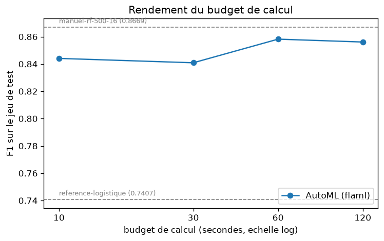

# TP04 : AutoML – Explorer les plateformes AutoML et MLOps low-code

**Filière :** 5IASD (2026-2027)  
**École :** École Marocaine des Sciences de l'Ingénieur (EMSI)  
**Étudiant :** Amine KHABOT  
**Dépôt GitHub :** [https://github.com/Amine-kh1/TP04_AutoML_LowCode](https://github.com/Amine-kh1/TP04_AutoML_LowCode)

---

## 🎯 Contexte et Objectifs

Ce TP compare trois paradigmes de modélisation sur le projet de détection de fraudes bancaires (5 000 transactions, données déséquilibrées) :
1. **Modèle de référence simple :** Régression Logistique scikit-learn ($F_1 = 0,7407$).
2. **Réglage manuel du TP2 :** Forêt Aléatoire 500 arbres, profondeur 16 ($F_1 = 0,8669$).
3. **Recherche AutoML locale :** **FLAML** évaluée sur plusieurs budgets de calcul (10s, 30s, 60s, 120s).

Le projet aborde également :
- L'auditabilité des essais AutoML via l'inspection des logs (`src/inspecter.py`).
- Le danger critique de la **fuite de données (Data Leakage)** (`src/fuite.py`).
- Une étude comparative sourcée avec les plateformes cloud managées (**Vertex AI**, **SageMaker Autopilot**, **Azure Automated ML**).

---

## 📁 Structure du Projet

```text
tp4-automl/
├── .gitignore                      # Ignore .venv, mlflow.db, mlartifacts, data/
├── requirements.txt                # Dépendances du projet (flaml[automl], mlflow, etc.)
├── donnees.py                      # Générateur synthétique des transactions v1
├── data/                           # Données locales (non versionnées dans Git)
│   └── transactions.csv
├── src/
│   ├── references.py               # Entraînement des baselines (Logistique & TP2 manuel)
│   ├── automl.py                   # Recherche FLAML paramétrable par budget
│   ├── automl_sklearn.py           # Plan B (AutoML scikit-learn maison)
│   ├── rendement.py                # Traçage du graphique budget vs F1-score
│   ├── inspecter.py                # Analyse et audit des essais du journal FLAML
│   └── fuite.py                    # Démonstration du piège de la fuite de données
├── reports/
│   ├── flaml_10s.log               # Journal des essais budget 10s
│   ├── flaml_30s.log               # Journal des essais budget 30s
│   ├── flaml_60s.log               # Journal des essais budget 60s
│   ├── flaml_120s.log              # Journal des essais budget 120s
│   ├── rendement.png               # Courbe de rendement F1 vs Budget
│   ├── capture1_mlflow.png         # Capture écran MLflow (runs et références)
│   ├── capture2_mlflow_compare.png # Capture écran MLflow (comparaison des 4 runs)
│   ├── capture4_inspecter.png      # Capture écran de la sortie d'inspection
│   ├── capture5_fuite.png          # Capture écran de la fuite de données
│   ├── comparatif.md               # Tableau comparatif des approches et analyse
│   └── Khabot_Amine_5IASD_G1.pdf   # Rapport final complet au format PDF
└── README.md
```

---

## 📊 Résultats et Synthèse des Expériences

### 1. Modèles de Référence vs Recherche AutoML

| Approche | Outil / Famille | Budget / Durée | $F_1$ Validation | $F_1$ Test |
|---|---|---|---|---|
| **Régression Logistique** | `scikit-learn` | 0.21 s | — | **0.7407** |
| **Réglage Manuel (TP2)** | `RandomForest (500, 16)` | 3.75 s | — | **0.8669** |
| **FLAML 10 s** | `lgbm` | 10.1 s | 0.8084 | **0.8441** |
| **FLAML 30 s** | `lgbm` | 30.1 s | 0.8145 | **0.8409** |
| **FLAML 60 s** | `xgboost` | 60.4 s | 0.8277 | **0.8582** |
| **FLAML 120 s** | `xgboost` | 120.4 s | 0.8277 | **0.8561** |

---

### 2. Graphique du Rendement du Budget de Calcul



> **Constat :** Dès 10 secondes de calcul, FLAML atteint un score compétitif ($F_1 = 0,8441$). Le pic de performance est atteint à 60 secondes ($F_1 = 0,8582$ avec XGBoost). Au-delà (120 secondes), la performance stagne ($F_1 = 0,8561$), confirmant la loi des rendements décroissants du temps machine.

---

### 3. Inspection des Essais FLAML (60 s)

Sur un budget de 60 secondes, FLAML a évalué **115 essais** en explorant 7 familles d'estimateurs :
- `lgbm` : 47 essais
- `xgboost` : 30 essais *(famille gagnante)*
- `rf` : 19 essais
- `extra_tree` : 8 essais
- `sgd` : 8 essais
- `xgb_limitdepth` : 2 essais
- `lrl1` : 1 essai

Configuration gagnante retenue (XGBoost) :
`{'n_estimators': 333, 'max_leaves': 4, 'min_child_weight': 0.06115, 'learning_rate': 0.17877, 'subsample': 0.7335, 'colsample_bytree': 0.9715}`

---

### 4. Le Piège de la Fuite de Données (Data Leakage)

L'injection de la variable rétroactive `num_dossier_litige` (créée uniquement après contestation par le client) produit :
- **En test :** $F_1 = 1,0$ (séparation parfaite, importance = 4.0 sur le numéro de litige et 0.0 sur toutes les autres variables).
- **En simulation de production (variable à 0) :** $F_1 = 0,0$ (effondrement total de la détection).

> **Conclusion critique :** L'AutoML ne possède aucune compréhension causale ou temporelle. Un score parfait est presque toujours la signature d'une fuite d'information.

---

## 📑 Tableau Comparatif Multi-Plateformes

Voir le fichier détaillé : [`reports/comparatif.md`](reports/comparatif.md).

| Approche | F1 test | Temps humain | Temps machine | Coût estimé (source, date) | Explicabilité | Export / réversibilité |
|---|---|---|---|---|---|---|
| **Logistique (ref.)** | 0.7407 | ~5 min | 0.21 s | 0 (poste local) | Maximale | Total |
| **Manuel (TP2)** | 0.8669 | ~2 h | 3.75 s | 0 (poste local) | Moyenne/Bonne | Total |
| **FLAML 60 s** | 0.8582 | ~10 min | 60.4 s | 0 (poste local) | Moyenne/Basse | Total |
| **Vertex AI AutoML** | non mesuré | ~15 min | 1 à 2 h | ~3.15 $ / heure de nœud (Google Cloud, oct. 2026) | Bonne | Faible / Lock-in |
| **SageMaker Autopilot** | non mesuré | ~15 min | 1 h | ~2.50 $ à 5.00 $ (AWS EC2, oct. 2026) | Bonne | Faible / Lock-in |
| **Azure Automated ML** | non mesuré | ~15 min | 30 à 60 min | ~1.50 $ à 4.00 $ (Azure Compute, oct. 2026) | Bonne | Faible / Lock-in |

---

## 🚀 Reproduction des Expériences

```powershell
# 1. Cloner le projet
git clone https://github.com/Amine-kh1/TP04_AutoML_LowCode.git
cd TP04_AutoML_LowCode

# 2. Créer et activer l'environnement virtuel
python -m venv .venv
.venv\Scripts\Activate.ps1
pip install -r requirements.txt

# 3. Générer le dataset
python donnees.py

# 4. Lancer le serveur MLflow local (Terminal 1)
mlflow server --host 127.0.0.1 --port 5000 --backend-store-uri sqlite:///mlflow.db --default-artifact-root ./mlartifacts

# 5. Exécuter les blocs expérimentaux (Terminal 2)
python src/references.py
python src/automl.py 10
python src/automl.py 30
python src/automl.py 60
python src/automl.py 120
python src/rendement.py
python src/inspecter.py reports/flaml_60s.log
python src/fuite.py
```
